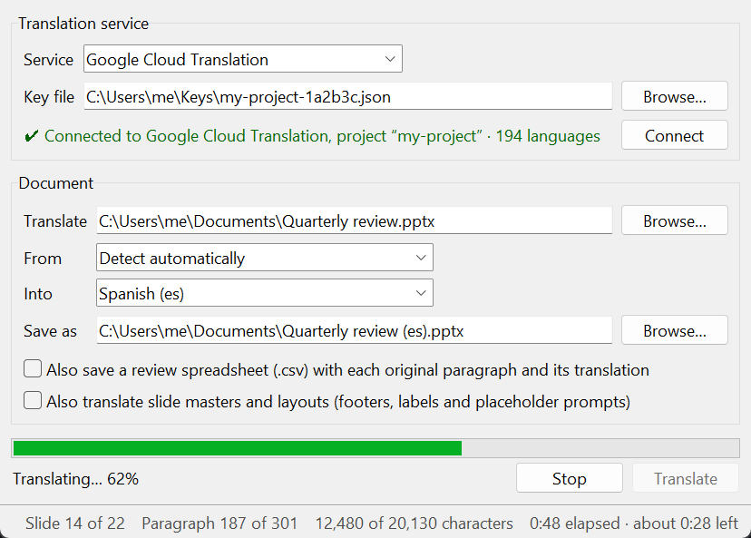

# Cicero user guide

Cicero makes a translated copy of a PowerPoint presentation (`.pptx`), a Word
document (`.docx`) or a PDF using Google Cloud Translation or DeepL. The original file is only ever
**read**; the translation is saved as a new file.

## Choosing a translation service

Cicero works with either service; you only need one.

| | Google Cloud Translation | DeepL |
|---|---|---|
| Languages | About 190 | Fewer, but with regional variants (British/American English, Brazilian/European Portuguese); the list appears when you connect |
| Free allowance | A monthly amount of characters on a billed project | 500 000 characters a month on the Free plan |
| Setup | Google Cloud project, API, service account key | DeepL account and an authentication key |
| Credentials in Cicero | A key file on your computer | A key you paste; optionally remembered in the system credential store |

Your documents go straight from your computer to the service you choose.

## Setting up Google Cloud

Cicero uses your own Google Cloud project, so translations are billed to you.
You need to do this once.

1. **Create a project.** In the [Google Cloud console](https://console.cloud.google.com/),
   open the project picker at the top and click **New project**. Cloud
   Translation needs **billing** to be enabled on the project, even within the
   free allowance.
2. **Enable the API.** Go to **APIs & Services → Library**, search for
   **Cloud Translation API** and click **Enable**.
3. **Create a service account.** Go to **IAM & Admin → Service Accounts →
   Create service account**. Give it a name such as `cicero`, and grant it the
   role **Cloud Translation API User**. Nothing else is needed.
4. **Create a key.** Open the new service account, go to the **Keys** tab and
   choose **Add key → Create new key → JSON**. A `.json` file downloads: this is
   the **key file** Cicero asks for.

Keep the key file private. Anyone who has it can translate text on your bill.
See [Keeping your keys safe](#keeping-your-keys-safe).

> **Can't create keys?** Organisations often forbid service account keys (the
> policy `iam.disableServiceAccountKeyCreation`). Use Application Default
> Credentials instead: install the [gcloud CLI](https://cloud.google.com/sdk/docs/install), run
>
> ```bash
> gcloud auth application-default login
> gcloud auth application-default set-quota-project YOUR_PROJECT_ID
> ```
>
> then leave **Key file** empty in Cicero and click **Connect**. Your Google
> account needs the *Cloud Translation API User* role on the project.

## Setting up DeepL

1. Sign up for the [DeepL API](https://www.deepl.com/pro-api). The **DeepL API
   Free** plan is enough to start; a regular DeepL (non-API) subscription doesn't
   include API access.
2. On deepl.com open **Account → API Keys** and copy your authentication key.
   Free-plan keys end in `:fx`; Cicero picks the right server from that.

Keep the key private, like a password.

## The window



### Translation service

- **Service**: *Google Cloud Translation* or *DeepL*. Switching connects to the
  other service straight away if Cicero already has its credentials. The language
  boxes then show that service's languages, and each service remembers the
  languages you last used with it.

For Google Cloud Translation:

- **Key file**: the service account key from the setup above. Choosing a file
  with **Browse…** connects straight away. If you type or paste a path, click
  **Connect**.
- Leave **Key file** empty to use Application Default Credentials (see the box
  above), or the file named by the `GOOGLE_APPLICATION_CREDENTIALS` environment variable.
- When the connection works, the line underneath shows the project and the
  number of languages available. Connecting only lists the languages; it doesn't
  translate anything and costs nothing.

Cicero remembers the key file's **location** and reconnects when it starts. It
never copies the key.

For DeepL:

- **Auth key**: paste the authentication key and click **Connect**. The line
  underneath shows your plan and how much of this period's character allowance
  you have used.
- **Remember**: keeps the key in the operating system's credential store
  (Windows Credential Manager, the macOS Keychain, or the Secret Service on
  Linux), never in a file, and reconnects when Cicero starts. Untick it and connect
  again to remove the stored key.

### Document

- **Translate**: the `.pptx`, `.docx` or `.pdf` file to translate. Older `.ppt` and `.doc`
  files must first be opened in PowerPoint or Word and saved as `.pptx` or `.docx`.
- **From**: the language the presentation is written in. *Detect automatically*
  works well for most presentations; pick the language yourself if the slides are
  mostly short labels, names or acronyms, which are hard to detect.
- **Into**: the language to translate into.
  Both boxes can be typed in: `span`, `Spanish` or `es` all find *Spanish (es)*.
  Regional variants have their own entries, e.g. *Portuguese (Portugal) (pt-PT)*
  and *Chinese (Traditional) (zh-TW)*.
- **Save as**: where to save the translation. It starts as
  `<original name> (<language code>).pptx` (or `.docx`, `.pdf`) in the same folder, and follows your
  language choice until you choose another path yourself. It can't be the
  original file.
- **Also save a review spreadsheet**: also writes a `.csv` file with the same name
  as the translation. It has one row per paragraph: the slide number, where on
  the slide it is, the original and the translation. It opens in Excel or any
  spreadsheet program and is handy for a proofreader.
- **Also translate slide masters and layouts**: the slide master and its layouts
  hold text that appears on every slide using them (a footer, a "Confidential"
  label, a section name) and the prompts PowerPoint shows in empty placeholders
  while you edit (*Click to edit Master title style*, *Click to add text*). Turn
  this on when the presentation is a template, or when that shared text is in the
  original language. Their rows in the review spreadsheet have slide number 0 and
  a location such as `Layout: Title Slide › Title 1`. Word documents and PDFs have
  no masters, so the option is greyed out for them.

### Translating

Click **Translate**. The progress bar shows how much of the text has been
translated, and the status bar at the bottom of the window counts:

- **Slide N of M**: the slide being translated.
- **Paragraph N of M**: paragraphs translated so far, out of all paragraphs found.
- **Characters**: what has been sent to Google so far, out of the total. This is
  what Google bills for.
- **Elapsed** and **about … left**: the time left is estimated from the speed so far,
  and appears once the first batch has come back.

When the job ends the status bar keeps the totals.

The window stays usable and you can click **Stop** at any time:
Cicero finishes the request already on its way to Google, then stops without
saving anything.

When it's done, a message shows where the translation was saved and offers to
open it.

## What gets translated

### Presentations

| Translated | Not translated |
|------------|----------------|
| Slide titles and placeholders | Text inside pictures |
| Text boxes and shapes, including inside groups (and groups of groups) | Charts (titles, labels, data) |
| Table cells | Comments |
| SmartArt | |
| Speaker notes | |
| Slide masters and layouts, if you ask for it (see below) | |
| | Text with no letters: numbers, dates such as `2024`, symbols, bullets |

### Word documents

| Translated | Not translated |
|------------|----------------|
| Body text, headings, lists | Text inside pictures |
| Tables, including tables inside tables | Charts and SmartArt |
| Text boxes | Field codes (tables of contents and page numbers update when Word refreshes fields) |
| Headers and footers | Deleted text in tracked changes (insertions are translated) |
| Footnotes, endnotes and comments | Text with no letters |

Word documents have no fixed pages (Word lays them out when it opens the file),
so the status bar shows paragraphs and characters only, and the review
spreadsheet has no page column; its *Location* says `Body`, `Body › Table`,
`Header`, `Footnotes` and so on.

### PDFs

A PDF has no paragraphs or text boxes, only letters placed on the page. Cicero
reads the text in blocks (roughly paragraphs), translates each block, removes the
original letters and writes the translation in the same place:

- Font size, bold, italic and colour are kept for each part of the block. The
  typeface is replaced by a standard one of the same kind (sans-serif, serif or
  monospaced), because PDFs usually contain only the letters their text uses.
- Pictures, drawings, lines, backgrounds and shaded boxes are not touched.
- Longer translations first use the free space to the right of one-line text and
  below every block, without running into other text, pictures or out of a box the
  text sits in. Only if that isn't enough is the text made smaller. If it still
  doesn't fit, the end message says how many paragraphs may be cut off.
- Words hyphenated at the end of a line are joined before translating.

What isn't translated:

- **Scanned PDFs** (pictures of pages) contain no text. Run them through OCR first,
  for example with Adobe Acrobat or [ocrmypdf](https://ocrmypdf.readthedocs.io/).
- Rotated or vertical text, text inside pictures, and form fields.
- **Password-protected PDFs** can't be opened; remove the password first.

The result is meant for reading. Complex layouts (several columns, text flowing
around pictures) can look less tidy than the original; when you have the source
document (Word or PowerPoint), translating that gives better results.

### Formatting

Each paragraph keeps its formatting. When a paragraph mixes formats (a bold word,
a link, a colour), Cicero tells the translator which words belong together and
puts each part of the translation back into the matching run. Because word order
changes between languages, the bold part may move within the sentence, which is
what you want. Occasionally the translator merges two parts; their text then
takes the formatting of the first one.

Translated text is often longer than the original (German and French are
typically 20–30 % longer than English). PowerPoint's *Shrink text on overflow*
setting helps; otherwise check slides with tight text boxes afterwards.

## Keeping your keys safe

- Store the key file outside any folder that is synchronised publicly or
  committed to Git. This project's `.gitignore` ignores `*.json` to make
  accidents less likely.
- Never email the key or paste it into chat or tickets. Give each person their
  own service account or key instead, so one can be disabled without affecting the rest.
- If a key might have leaked, **delete it** in the Google Cloud console (**IAM & Admin →
  Service Accounts → *account* → Keys**) and create a new one. Deleting a key
  stops it working immediately, everywhere.
- Consider setting a budget alert under **Billing → Budgets & alerts**.
- For DeepL, a leaked key can be deleted and replaced under **Account → API Keys**.
  DeepL also lets you set a cost control limit on Pro plans.

## Troubleshooting

**"The Cloud Translation API isn't enabled for project …"**
: Enable it under **APIs & Services → Library → Cloud Translation API**. It can
  take a minute or two to take effect.

**"The service account isn't allowed to use Cloud Translation"**
: Give the service account the **Cloud Translation API User** role under
  **IAM & Admin → IAM** in the same project the key belongs to.

**"Billing isn't enabled for project …"**
: Link a billing account to the project under **Billing**.

**"DeepL rejected the authentication key"**
: Copy the key again from **Account → API Keys** on deepl.com. Keys from a regular
  DeepL subscription without API access don't work.

**"Your DeepL character quota for this period is used up"**
: Wait for the next period, upgrade the plan, or switch to Google Cloud Translation.

**A language I need isn't in the list**
: Each service supports its own set of languages. Switch the **Service** to the
  other one.

**"Google rejected the key"**
: The key was deleted or disabled, or its service account was removed. Create a new key.

**"This isn't a service account key"**
: You chose another kind of Google file, often an *OAuth client ID*
  (`client_secret_….json`). Create a service account key as described in
  [Setting up Google Cloud](#setting-up-google-cloud).

**"Can't write the file. Is it open in PowerPoint?"**
: Close the file in PowerPoint (or choose another **Save as** name) and try again.

**"This isn't a PowerPoint .pptx file" / "This isn't a Word .docx file"**
: Cicero reads `.pptx` and `.docx`. Open `.ppt`, `.doc`, `.odp` or `.odt` files in
  PowerPoint, Word or LibreOffice and save them as `.pptx` or `.docx`.

**"No module named tkinter" or "No module named _tkinter"** (Linux)
: Install Tkinter for your Python, e.g. `sudo apt install python3-tk`.

**Some text stayed in the original language**
: It is probably in a chart, SmartArt, a picture or the slide master (see
  [What gets translated](#what-gets-translated)), or it was in a language Google
  didn't detect: set **From** explicitly.

**"This PDF is password-protected"**
: Open it in a PDF reader and save or print it to a new PDF without a password.

**A translated PDF came out unchanged**
: It is probably a scan. See [PDFs](#pdfs).

**I see `.….cicero-partial` files**
: They are left only if Cicero was killed while saving (for example from Task
  Manager or a power cut). They are safe to delete.
